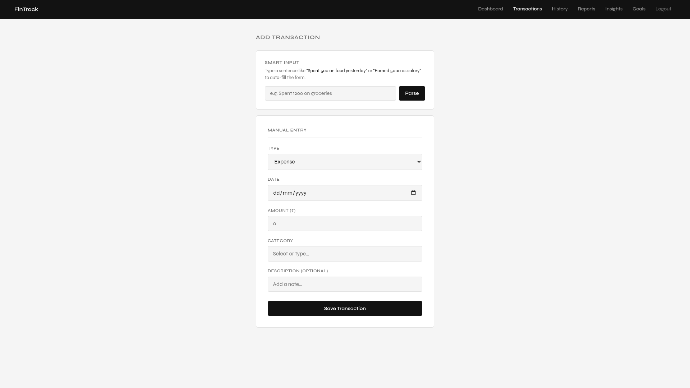
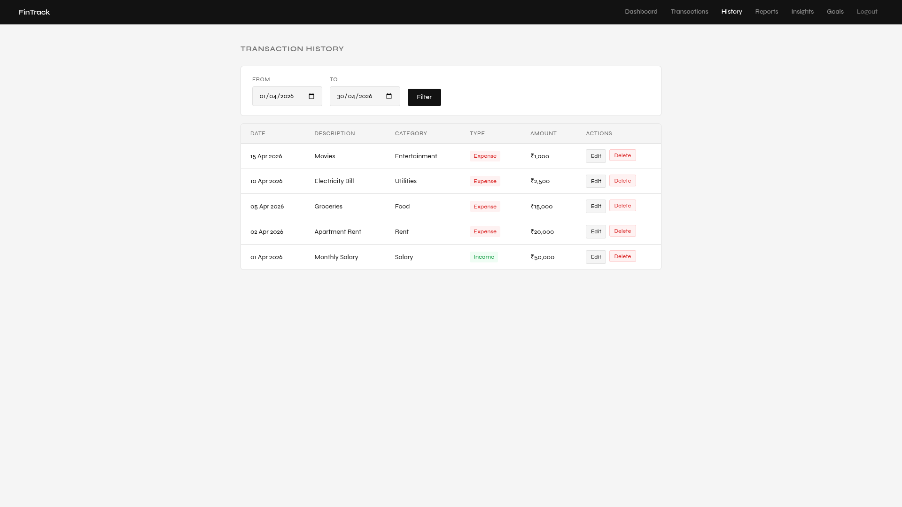
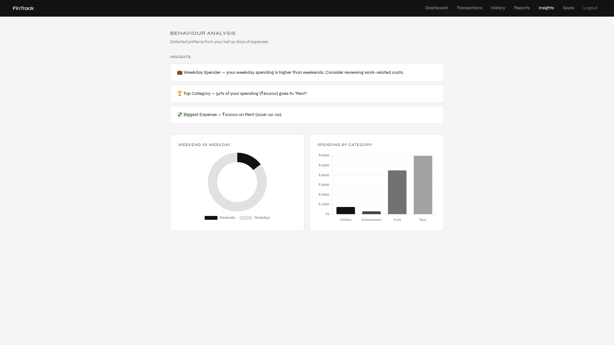

# FinTrack

FinTrack is a clean, minimalist web-based finance tracker built on Spring Boot. Users can log income and expenses from a single transaction page (by hand, or by typing a plain-English sentence), browse and edit their transaction history, view charts of their spending, get automatic insights into their spending habits, and track savings goals with on-track predictions.

---

## 🎨 Screenshots

### Dashboard


### Add Transaction


### Transaction History


### Behaviour Insights


---

## 🚀 Features

*   **User Authentication**: Session-based registration, login and logout. Passwords are hashed with BCrypt before being stored. Every page redirects to the login screen if no user is signed in.
*   **Dashboard**: This month's income, expenses and net balance, a next-month expense forecast, a 4-month expense trend, and your most recent transactions.
*   **Unified Transaction Entry**: A single page (`/transaction`) for logging both income and expenses, with a type selector and a `datalist` of common categories.
*   **Smart Input (NLP Parser)**: Type a sentence such as *"Spent 500 on food yesterday"* or *"Earned 5000 as salary"* and FinTrack pre-fills the form for you to review and save. The parser picks out:
    *   **Amount**: the largest number in the sentence (supports `₹`, `rs` and `inr` prefixes; years like `2026` are ignored).
    *   **Category**: matched from keywords (e.g. *uber* → Transport, *netflix* → Entertainment, *rent* → Housing); defaults to `Other`.
    *   **Date**: relative words such as *today*, *yesterday*, *last week*, *last month* or a weekday name (*monday* → the most recent Monday); defaults to today.
    *   **Type**: words like *earned*, *salary*, *received*, *income* or *gift* mark it as income; everything else is an expense.
*   **Transaction History**: All transactions within a chosen date range (defaults to the current month), with `Edit` and `Delete` controls on every row.
*   **Expense Forecast**: Predicts next month's spending using a weighted average of the last three months (50% / 30% / 20%), and shows the month-over-month trend.
*   **Behaviour Insights**: Analyses the last 90 days of expenses to flag patterns: weekend vs weekday spending, your top category, whether purchase frequency is rising or falling, your biggest single expense, and recurring habits. Includes a weekend/weekday doughnut chart and a spending-by-category bar chart.
*   **Smart Goals**: Create savings goals with a target amount and date, add deposits over time, and see a progress bar with a status prediction (**Achieved**, **On Track**, **At Risk** or **Behind**) based on your average daily savings rate so far.
*   **Reports**: A Chart.js stacked bar chart of this year's expenses, broken down by month and category.
*   **Persistent MariaDB Backend**: Data is stored in MariaDB through Spring Data JPA / Hibernate. Database credentials come from environment variables, never from committed files.

---

## 🛠️ Technology Stack

*   **Backend**: Java 17, Spring Boot 4, Spring MVC, Spring Data JPA
*   **Frontend**: HTML5, vanilla CSS3, Thymeleaf
*   **Database**: MariaDB with Hibernate
*   **Data Visualization**: Chart.js (loaded from CDN)

---

## 📂 Project Structure

```
fintrack/
├── images/                                 # README screenshots
├── src/
│   ├── main/
│   │   ├── java/com/financetracker/fintrack/
│   │   │   ├── FintrackApplication.java    # Application entry point
│   │   │   ├── controller/
│   │   │   │   ├── AuthController.java         # Login, registration, logout
│   │   │   │   ├── MainController.java         # Dashboard, history, reports
│   │   │   │   ├── TransactionController.java  # Add/edit/delete transactions, NLP input
│   │   │   │   ├── InsightsController.java     # Behaviour insights page
│   │   │   │   └── GoalController.java         # Savings goals and deposits
│   │   │   ├── model/                      # JPA entities (User, Transaction, Goal)
│   │   │   ├── repository/                 # Spring Data repositories
│   │   │   └── service/
│   │   │       ├── UserService.java            # Registration and login
│   │   │       ├── TransactionService.java     # Totals, forecast, behaviour insights
│   │   │       ├── GoalService.java            # Goal CRUD and status prediction
│   │   │       └── NlpParserService.java       # Plain-English sentence → Transaction
│   │   └── resources/
│   │       ├── application.properties      # MariaDB connection (via env vars) and Spring configuration
│   │       └── templates/                  # Thymeleaf HTML views
│   │           ├── index.html              # Dashboard
│   │           ├── login.html              # Login screen
│   │           ├── register.html           # Registration screen
│   │           ├── add-transaction.html    # Smart input + manual income/expense form
│   │           ├── history.html            # Date-filtered transaction list
│   │           ├── edit-transaction.html   # Edit an existing transaction
│   │           ├── reports.html            # Monthly stacked bar chart by category
│   │           ├── insights.html           # Behaviour insights and charts
│   │           └── goals.html              # Savings goals with predictions
│   └── test/                               # Spring Boot context test
├── pom.xml                                 # Maven dependencies
└── README.md                               # Project documentation
```

---

## ⚙️ Setup and Installation

### Prerequisites
*   **Java 17** (or above)
*   **Maven** (or use the included `./mvnw` wrapper)
*   **MariaDB** server

### 1. Create the Database
Log in to MariaDB as an admin and create a schema and a user for FinTrack (pick your own password):
```sql
CREATE DATABASE fintrack;
CREATE USER 'finuser'@'localhost' IDENTIFIED BY 'choose-a-strong-password';
GRANT ALL PRIVILEGES ON fintrack.* TO 'finuser'@'localhost';
FLUSH PRIVILEGES;
```
Tables are created automatically the first time the app starts.

### 2. Set Your Database Credentials
FinTrack reads its database credentials from environment variables, so no passwords are stored in the repository. Set them in the terminal you will run the app from:
```bash
# bash / zsh
export DB_USERNAME=finuser
export DB_PASSWORD='choose-a-strong-password'
```
```fish
# fish
set -x DB_USERNAME finuser
set -x DB_PASSWORD 'choose-a-strong-password'
```
`DB_URL` is optional and defaults to `jdbc:mariadb://localhost:3306/fintrack`. Set it if your database is on another host, port or schema name.

### 3. Build the Application
From the project root:
```bash
./mvnw clean install
# OR
mvn clean install
```

### 4. Run the Application
```bash
./mvnw spring-boot:run
# OR
mvn spring-boot:run
```

The app starts on port 8080. **Open your browser and go to:** `http://localhost:8080`, then register an account and log in.
